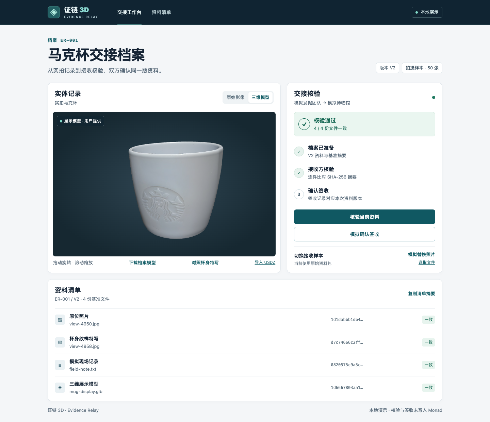

# 证链 3D · Evidence Relay

面向实体物品交接的三维资料核验工具：登记方固定资料版本，接收方查看模型与照片、核验文件摘要，并使用指定钱包在 Monad 测试网上签收。

适用于藏品交接、样本移交和物品数字档案验收。本项目展示资料版本一致性，不证明实物真伪，也不证明资料采集过程真实。



- GitHub 仓库：https://github.com/JiaGuu/MonadBliz
- 前端演示：https://jiaguu.github.io/MonadBliz/
- 关联活动：Monad Blitz@广州

## 主要功能

- 浏览马克杯三维 GLB 模型、原位照片与现场记录。
- 浏览器计算 SHA-256，对照 V2 清单核验四份基准文件。
- 替换照片或切换另一个杯子的模型，演示核验失败和签收拦截。
- 登记交接摘要及指定接收人，接收人通过钱包签收一次。
- 使用交接编号查询链上状态；原始照片和模型不上链。

## 技术栈与目录

Next.js 16、React 19、TypeScript、Three.js、viem、Solidity 0.8.28、Foundry、Monad Testnet。

- `webapp/`：前端及公开样本资源。
- `contracts/src/EvidenceRelay.sol`：交接合约。
- `contracts/deployment-testnet.json`：测试网部署回执。
- `.github/workflows/pages.yml`：GitHub Pages 自动部署。
- `docs/evidence-relay.png`：核心功能截图，可用于参赛材料。

目录内保留原始 NFT 模板代码，其功能不属于当前证链演示流程。

## 安装与本地运行

需要 Node.js 22 和 npm。在项目根目录运行：

```bash
cd webapp
npm ci
cp .env.example .env.local
# 在 .env.local 中设置：
# NEXT_PUBLIC_EVIDENCE_CONTRACT_ADDRESS=0xE22987a485D622E66921051C59DF995896719050
npm run dev -- --webpack
```

打开终端打印的网址。留空合约地址时运行本地核验及模拟签收；配置地址后启用测试网登记与签收。核验依赖 Web Crypto，请使用 localhost 或 HTTPS。

```bash
# 前端检查与生产编译
npm run typecheck
npx next build --webpack
# 合约编译（从项目根目录执行）
cd contracts
npm ci
npm run compile
```

## 测试网体验

无需演示账号和密码。请使用装有 MetaMask 的浏览器和两个持有测试 MON 的账户；不要使用真实资产或公开私钥。

网络为 Monad Testnet，Chain ID `10143`，RPC `https://testnet-rpc.monad.xyz`。

合约：[`0xE22987a485D622E66921051C59DF995896719050`](https://testnet.monadexplorer.com/address/0xE22987a485D622E66921051C59DF995896719050)。

[部署交易](https://testnet.monadexplorer.com/tx/0x0d56255886e66e077ce1275fc97c59cc858eb9eb5aaf6176c8620febb3d70a41)。

1. A 在「博物馆钱包」填写 B 地址，用 A 登记并保存交接编号。
2. 切换到 B，查询编号，模拟收到另一个杯子，再核验：应为 3/4 一致，签收不可用。
3. 恢复登记模型并重新核验：应为 4/4 一致，用 B 确认签收交易。
4. 刷新后重新查询同一编号，确认链上已签收，并保存交易链接。

部署交易已确认成功；本地模型替换核验已由用户验证。完整链上签收验收仍需完成，不能将本地模拟签收视为链上验收。

## 发布到 GitHub Pages

仓库应为 Public。在仓库 Settings → Pages → Build and deployment 中选择 GitHub Actions。

推送到 `main` 后，工作流安装依赖、检查类型并静态导出网站，随后部署到 Pages。打开 Actions 中的部署地址即可访问。工作流自动设置仓库子路径和已部署合约地址，不需要提交 `.env.local`。

## 许可和样本说明

暂未授予开源许可证；公开源码用于项目审阅。第三方依赖遵循各自许可证。照片与模型是演示样本，现场记录为模拟内容，不代表真实文物或博物馆业务。
